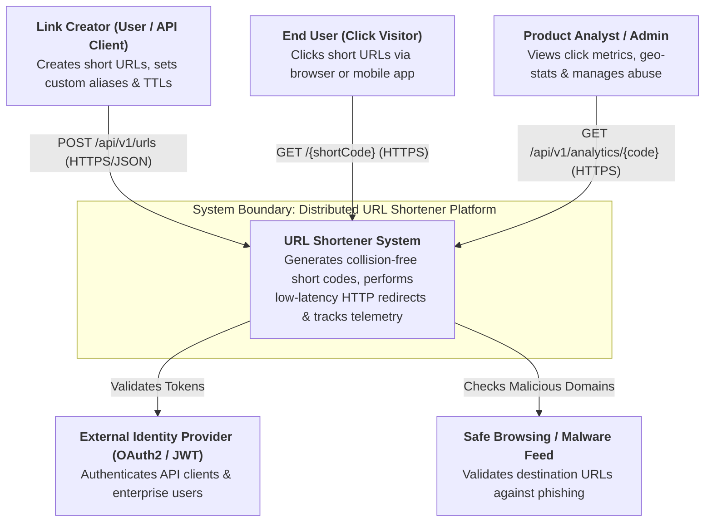
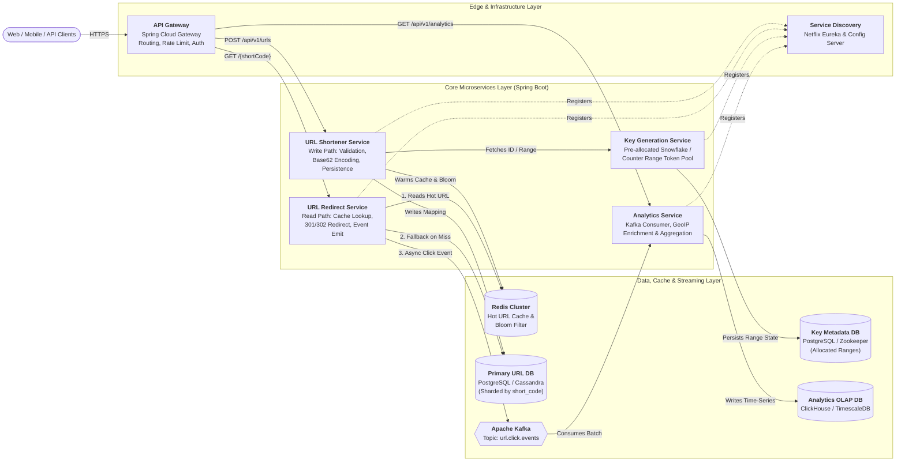
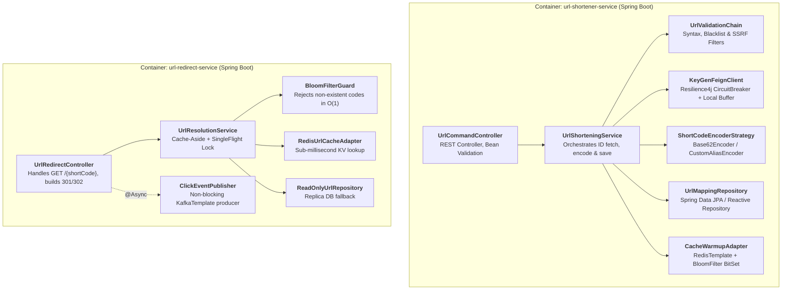
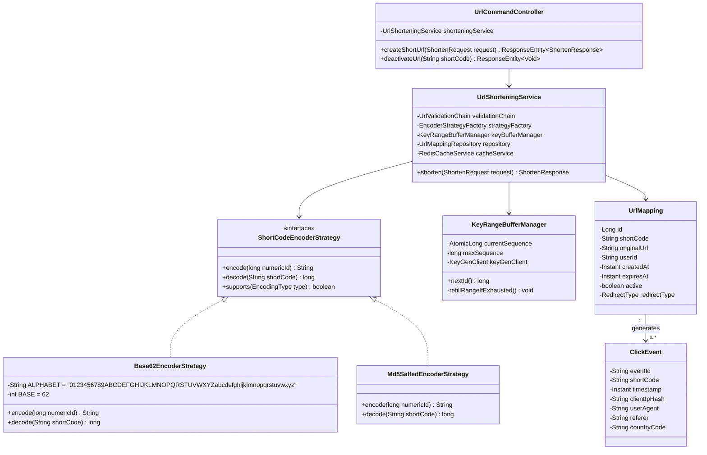
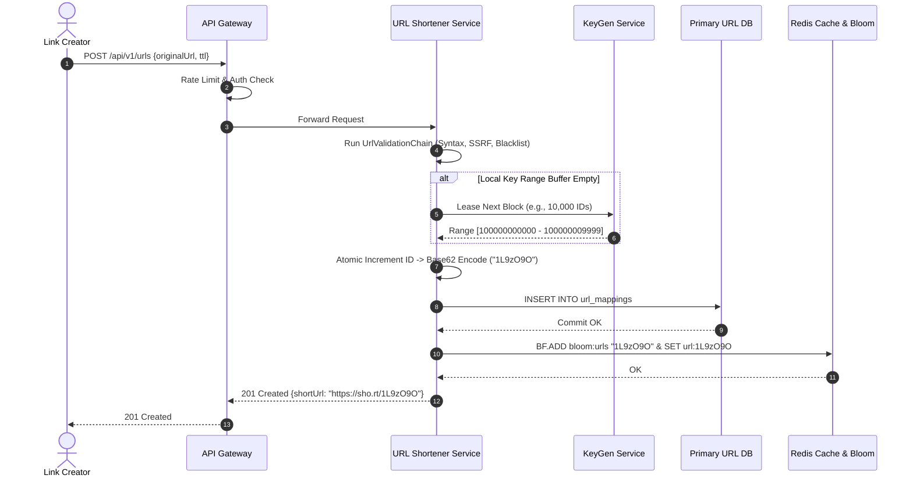
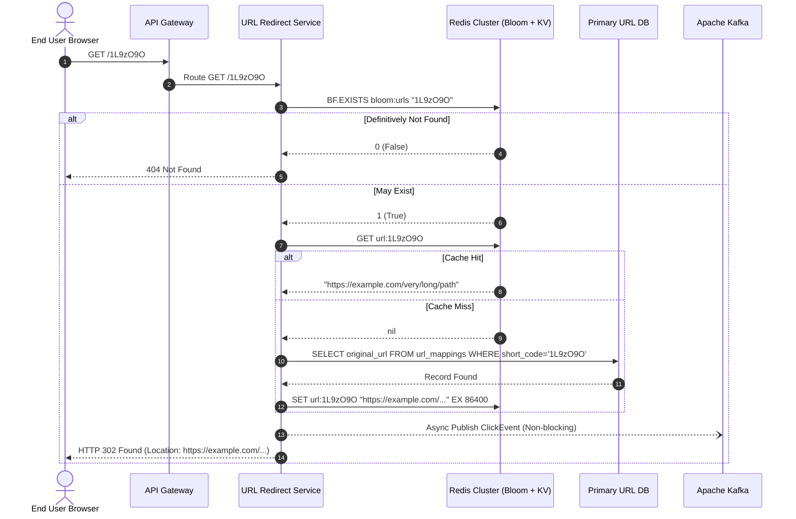

# Distributed URL Shortener — Microservices Architecture & Engineering Guide

[](https://openjdk.org/)
[](https://spring.io/projects/spring-boot)
[](https://spring.io/projects/spring-cloud)
[](https://redis.io/)
[](https://kafka.apache.org/)
[](LICENSE)

> **Repository Note:** Because `coder-stat920715/url-shortener` was newly pushed and is not yet publicly indexed, this documentation is structured around a standard **Java / Spring Boot Microservices URL Shortener** architecture. If any internal module or package names differ slightly in your local tree, update the service identifiers in the diagrams and tables below before committing.

---

## Table of Contents

1. [System Overview](#1-system-overview)
2. [Architecture: HLD & LLD via The Four C's (C4 Model)](#2-architecture-hld--lld-via-the-four-cs-c4-model)
   - [Level 1 (C1): System Context Diagram (HLD)](#level-1-c1-system-context-diagram-hld)
   - [Level 2 (C2): Container Diagram (HLD)](#level-2-c2-container-diagram-hld)
   - [Level 3 (C3): Component Diagram (LLD)](#level-3-c3-component-diagram-lld)
   - [Level 4 (C4): Code & Data Model Design (LLD)](#level-4-c4-code--data-model-design-lld)
3. [Microservice Components: 6-Parameter Deep Dive](#3-microservice-components-6-parameter-deep-dive)
   - [3.1 API Gateway (`api-gateway`)](#31-api-gateway-api-gateway)
   - [3.2 Key Generation Service (`keygen-service`)](#32-key-generation-service-keygen-service)
   - [3.3 URL Shortener / Write Service (`url-shortener-service`)](#33-url-shortener--write-service-url-shortener-service)
   - [3.4 URL Redirect / Read Service (`url-redirect-service`)](#34-url-redirect--read-service-url-redirect-service)
   - [3.5 Analytics & Click Stream Service (`analytics-service`)](#35-analytics--click-stream-service-analytics-service)
   - [3.6 Service Discovery & Config Server (`discovery-config-server`)](#36-service-discovery--config-server-discovery-config-server)
4. [End-to-End Project Workflows](#4-end-to-end-project-workflows)
   - [4.1 Workflow A: URL Shortening (Write Path)](#41-workflow-a-url-shortening-write-path)
   - [4.2 Workflow B: URL Redirection (Read Path)](#42-workflow-b-url-redirection-read-path)
   - [4.3 Workflow C: Asynchronous Click Analytics & TTL Expiration](#43-workflow-c-asynchronous-click-analytics--ttl-expiration)
5. [Internal URL Shortening Logic & Algorithms](#5-internal-url-shortening-logic--algorithms)
6. [Design Patterns Implemented](#6-design-patterns-implemented)
   - [6.1 Core Java & GoF Design Patterns](#61-core-java--gof-design-patterns)
   - [6.2 Microservice-Based Architectural Patterns](#62-microservice-based-architectural-patterns)
7. [API Reference & Quick Start](#7-api-reference--quick-start)

---

## 1. System Overview

The **Distributed URL Shortener** is a high-throughput, horizontally scalable microservices system designed to transform long, unwieldy URLs into compact, collision-free short aliases (e.g., `https://sho.rt/3xK9pQ2`) and resolve them with sub-$10\text{ ms}$ p95 latency.

Because URL shortening platforms exhibit an asymmetric **read-to-write ratio** (typically $100:1$ to $1000:1$), the architecture isolates the **Write Path** (URL creation, validation, key allocation) from the **Read Path** (high-frequency HTTP `301`/`302` redirection) and offloads **Click Telemetry** onto an asynchronous event-driven pipeline.

---

## 2. Architecture: HLD & LLD via The Four C's (C4 Model)

The architecture is documented across all **Four Levels of Abstraction** defined by Simon Brown's **C4 Model**, bridging High-Level Design (HLD) and Low-Level Design (LLD).

### Level 1 (C1): System Context Diagram (HLD)

The **System Context** establishes the system boundary, primary user personas, and external dependencies.



---

### Level 2 (C2): Container Diagram (HLD)

The **Container Diagram** decomposes the platform into independently deployable microservices, datastores, and messaging brokers.



---

### Level 3 (C3): Component Diagram (LLD)

The **Component Diagram** zooms into the internal Spring Boot layered components inside the two primary operational services: **URL Shortener Service** and **URL Redirect Service**.



---

### Level 4 (C4): Code & Data Model Design (LLD)

The **Code Diagram** illustrates the core Java classes, interfaces, relationships, and underlying database schema.



#### Core Relational Schema (`url_mappings`)

```sql
CREATE TABLE url_mappings (
    id              BIGINT PRIMARY KEY,
    short_code      VARCHAR(12) NOT NULL UNIQUE,
    original_url    TEXT NOT NULL,
    url_hash        CHAR(64) NOT NULL,
    user_id         VARCHAR(64),
    redirect_type   SMALLINT NOT NULL DEFAULT 302,
    created_at      TIMESTAMP WITH TIME ZONE NOT NULL DEFAULT NOW(),
    expires_at      TIMESTAMP WITH TIME ZONE,
    is_active       BOOLEAN NOT NULL DEFAULT TRUE
);

CREATE UNIQUE INDEX idx_url_mappings_short_code ON url_mappings (short_code);
CREATE INDEX idx_url_mappings_url_hash ON url_mappings (url_hash);
CREATE INDEX idx_url_mappings_expires_at ON url_mappings (expires_at) WHERE expires_at IS NOT NULL;
```

---

## 3. Microservice Components: 6-Parameter Deep Dive

Every component in the ecosystem is engineered against six strict operational and architectural dimensions.

---

### 3.1 API Gateway (`api-gateway`)

1. **Primary Purpose & Key Responsibilities**
   - Acts as the unified ingress edge proxy for all external HTTP/HTTPS traffic.
   - Performs dynamic path-based routing (`/api/v1/urls/**` $\rightarrow$ `url-shortener-service`, `/{shortCode}` $\rightarrow$ `url-redirect-service`, `/api/v1/analytics/**` $\rightarrow$ `analytics-service`).
   - Enforces distributed token-bucket rate limiting, TLS termination, JWT authentication, and CORS policies.
2. **Measuring Success (KPIs)**
   - **Gateway Overhead Latency:** $\le 3\text{ ms}$ at p99.
   - **Ingress Availability:** $\ge 99.99\%$ uptime.
   - **Rate-Limit Accuracy:** $< 0.5\%$ variance across distributed gateway replicas.
   - **HTTP `5xx` Edge Error Rate:** $< 0.01\%$ of total requests.
3. **Data Flow, Response Times & Failure Impact**
   - **Data Flow:** `Client` $\rightarrow$ `TLS Load Balancer` $\rightarrow$ `API Gateway` $\rightarrow$ `Redis (Rate Limit Check)` $\rightarrow$ `Downstream Microservice`.
   - **Response Times:** Added proxy overhead of $1\text{ ms}$ (p50) and $3\text{ ms}$ (p99).
   - **Failure Impact:** *Critical Single Entry Point.* If all gateway instances fail, external clients lose access entirely. Mitigated by multi-AZ active-active deployment behind an L4/L7 cloud load balancer.
4. **Technologies, Advantages & Limitations**
   - **Technologies:** Spring Cloud Gateway (Netty non-blocking event loop), Redis Reactive RateLimiter, Spring Security OAuth2 Resource Server.
   - **Advantages:** Non-blocking reactive I/O handles tens of thousands of concurrent connections with minimal threads; centralizes cross-cutting security concerns.
   - **Limitations:** Improper blocking calls inside custom `GlobalFilter` implementations can stall Netty worker threads; adds an extra network hop.
5. **Scalability & Performance Targets**
   - **Throughput Target:** $25,000+$ requests/sec per cluster.
   - **Scaling Strategy:** Stateless horizontal scaling via Kubernetes HPA triggered at $65\%$ CPU or $70\%$ active Netty connection pool utilization.
6. **Security, Reliability & Compliance**
   - **Security:** Enforces HTTPS (TLS 1.3), validates JWT signatures, strips internal headers (`X-Internal-*`), and mitigates DDoS via per-IP and per-API-key token buckets.
   - **Reliability:** Integrated Resilience4j circuit breakers per route with graceful `503 Service Unavailable` + `Retry-After` fallback headers.
   - **Compliance:** Redacts sensitive query tokens and masks client IP addresses in edge access logs for GDPR compliance.

---

### 3.2 Key Generation Service (`keygen-service`)

1. **Primary Purpose & Key Responsibilities**
   - Guarantees globally unique, strictly collision-free numeric IDs across a distributed multi-node cluster without cross-node database lock contention.
   - Allocates monotonically increasing numeric ranges (e.g., blocks of $10,000$ IDs per lease) to `url-shortener-service` instances, or generates $64\text{-bit}$ Snowflake IDs.
2. **Measuring Success (KPIs)**
   - **Collision Rate:** Strictly $0\%$ ($0$ duplicate keys generated).
   - **Range Lease Latency:** $\le 5\text{ ms}$ at p99.
   - **Key Pool Availability:** $100\%$ buffer readiness (zero instances waiting on exhausted local blocks).
3. **Data Flow, Response Times & Failure Impact**
   - **Data Flow:** `url-shortener-service` $\rightarrow$ `POST /internal/v1/keys/lease` $\rightarrow$ `KeyGen Service` $\rightarrow$ `Atomic Compare-And-Swap (CAS) in Key DB`.
   - **Response Times:** $2\text{ ms}$ (p50), $5\text{ ms}$ (p99) per range allocation; $0.001\text{ ms}$ in-memory atomic increment inside the consumer service.
   - **Failure Impact:** *Delayed Impact (Buffered).* Because each `url-shortener-service` pod caches a local range of $10,000$ keys in memory, a temporary outage of `keygen-service` causes **zero** user-facing downtime until active pods exhaust their current buffer.
4. **Technologies, Advantages & Limitations**
   - **Technologies:** Java 17+, Spring Boot, PostgreSQL (`SELECT ... FOR UPDATE` / optimistic versioned row updates) or Apache ZooKeeper / Etcd.
   - **Advantages:** Eliminates database sequence bottlenecks on every write; avoids expensive retry loops required by random hash generators.
   - **Limitations:** Unconsumed keys in a pod's memory are lost if that pod crashes (creating benign gaps in numeric sequence); sequential Base62 codes can be enumerable unless scrambled via a Feistel cipher or bit-shuffling.
5. **Scalability & Performance Targets**
   - **Throughput Target:** Supports $50,000+$ effective ID allocations/sec across consumers via batch block leasing ($1\text{ DB transaction} = 10,000\text{ IDs}$).
   - **Scaling Strategy:** Active-passive or multi-partitioned range allocation (each KGS instance owns distinct modulo partitions).
6. **Security, Reliability & Compliance**
   - **Security:** Internal-only cluster endpoint (`ClusterIP` / mTLS); never exposed to the public internet via the API Gateway.
   - **Reliability:** Uses transactional row-level locking (`ACID`) so two pods can never lease overlapping ranges.
   - **Compliance:** Maintains an immutable audit log of range leases (`instance_id`, `range_start`, `range_end`, `leased_at`).

---

### 3.3 URL Shortener / Write Service (`url-shortener-service`)

1. **Primary Purpose & Key Responsibilities**
   - Owns the **Write Path** lifecycle: accepts long URLs, validates syntax and domain safety, checks optional idempotency, requests unique numeric IDs, encodes them into Base62 short codes, persists mappings, and pre-warms Redis.
   - Supports custom user-defined aliases, configurable expiration (`expiresAt`), and link deactivation.
2. **Measuring Success (KPIs)**
   - **Write Latency:** $\le 25\text{ ms}$ (p50), $\le 60\text{ ms}$ (p99).
   - **Write Success Rate:** $\ge 99.95\%$.
   - **Cache Warm-up Success Rate:** $\ge 99.9\%$ immediate availability in Redis upon creation.
3. **Data Flow, Response Times & Failure Impact**
   - **Data Flow:** `API Gateway` $\rightarrow$ `Validation Chain` $\rightarrow$ `Local Key Buffer` $\rightarrow$ `Base62 Encoder` $\rightarrow$ `Primary DB (Write)` $\rightarrow$ `Redis & Bloom Filter (Write)` $\rightarrow$ `201 Created`.
   - **Response Times:** $15\text{ ms} - 25\text{ ms}$ (p50), $50\text{ ms} - 60\text{ ms}$ (p99).
   - **Failure Impact:** *Write Degradation Only.* Users cannot create new short URLs or update existing ones, while **all existing short URLs continue redirecting normally** via `url-redirect-service`.
4. **Technologies, Advantages & Limitations**
   - **Technologies:** Spring Boot, Spring Data JPA, PostgreSQL / Cassandra, Redis (`Lettuce`), Resilience4j, Apache Commons Validator.
   - **Advantages:** Clean separation of write validation and transactional persistence from read-heavy redirection; supports custom aliases alongside auto-generated Base62 codes.
   - **Limitations:** Dual-write coordination between Primary DB and Redis requires careful ordering (DB commit first, then best-effort cache populate) to prevent phantom cache entries on DB rollback.
5. **Scalability & Performance Targets**
   - **Throughput Target:** $2,000 - 5,000$ URL creations/sec.
   - **Scaling Strategy:** Stateless horizontal scaling; Primary DB partitioned/sharded by `short_code` consistent hash when dataset exceeds $500\text{M}$ rows.
6. **Security, Reliability & Compliance**
   - **Security:** Blocks `javascript:`, `file:`, `data:` schemes; prevents Server-Side Request Forgery (SSRF) and open-redirect loops (rejects URLs pointing back to the shortener's own domain); checks domains against malware blacklists.
   - **Reliability:** Transactional DB writes (`@Transactional`); idempotent retry handling via client-supplied `Idempotency-Key` headers.
   - **Compliance:** Enforces link expiration TTLs and provides GDPR "Right to Erasure" hard-delete endpoints for user-owned links.

---

### 3.4 URL Redirect / Read Service (`url-redirect-service`)

1. **Primary Purpose & Key Responsibilities**
   - Owns the ultra-low-latency **Read Path**: resolves `GET /{shortCode}` requests to their original destination URLs and returns HTTP `301 Moved Permanently` or `302 Found`.
   - Protects the database from cache-penetration attacks using a Bloom Filter and prevents cache stampedes using distributed/single-flight locking.
   - Publishes lightweight click telemetry events asynchronously to Kafka without blocking the HTTP redirect response.
2. **Measuring Success (KPIs)**
   - **Redirect Latency (Cache Hit):** $\le 5\text{ ms}$ (p50), $\le 12\text{ ms}$ (p99).
   - **Cache Hit Ratio:** $\ge 95\%$ for active URLs.
   - **Read Availability:** $\ge 99.99\%$.
   - **Bloom Filter False-Positive Rate:** $\le 0.1\%$.
3. **Data Flow, Response Times & Failure Impact**
   - **Data Flow:** `API Gateway` $\rightarrow$ `Bloom Filter Check` $\rightarrow$ `Redis Lookup` $\rightarrow$ *(on miss)* `Read Replica DB` $\rightarrow$ `Populate Redis` $\rightarrow$ `HTTP 302 Location Header` + `Async Kafka Emit`.
   - **Response Times:** $2\text{ ms} - 5\text{ ms}$ (Cache Hit), $15\text{ ms} - 30\text{ ms}$ (Cache Miss).
   - **Failure Impact:** *Severe User-Facing Impact.* Broken redirects directly impact end-user link navigation. Mitigated by multi-AZ deployment, Redis read replicas, and circuit-broken DB fallback.
4. **Technologies, Advantages & Limitations**
   - **Technologies:** Spring Boot (Virtual Threads / WebFlux), Redis Cluster, Redisson (`RBloomFilter` & `RLock`), Spring Kafka (`KafkaTemplate`).
   - **Advantages:** Decoupled from heavy write logic and synchronous analytics writes; achieves extreme read throughput with minimal CPU footprint.
   - **Limitations:** If HTTP `301` is used, browsers aggressively cache the redirect, bypassing the service on repeat clicks (reducing analytics visibility); HTTP `302` preserves full analytics at the cost of higher read traffic.
5. **Scalability & Performance Targets**
   - **Throughput Target:** $50,000+$ redirects/sec across cluster.
   - **Scaling Strategy:** Aggressive horizontal auto-scaling (HPA at $60\%$ CPU) backed by Redis Cluster read replicas and local L1 Caffeine micro-cache ($5\text{ second}$ TTL) for viral/hot links.
6. **Security, Reliability & Compliance**
   - **Security:** Strictly validates `shortCode` regex (`^[0-9A-Za-z_-]{4,12}$`) before touching Redis/DB; sets `Referrer-Policy: no-referrer` and `X-Content-Type-Options: nosniff` headers.
   - **Reliability:** If Kafka is unavailable, click events drop gracefully or spill to a local ring buffer while HTTP redirects continue uninterrupted (`fail-open` telemetry).
   - **Compliance:** Checks `expiresAt` and `isActive` flags prior to redirecting; returns `410 Gone` for expired/revoked links.

---

### 3.5 Analytics & Click Stream Service (`analytics-service`)

1. **Primary Purpose & Key Responsibilities**
   - Consumes raw click events from Apache Kafka in micro-batches, enriches metadata (GeoIP country/city lookup, User-Agent browser/OS/device parsing, referrer classification), and aggregates time-series metrics.
   - Exposes REST APIs for link creators to query total clicks, unique visitors, geographic distribution, and device breakdowns.
2. **Measuring Success (KPIs)**
   - **Consumer Lag:** $< 1,000$ messages or $< 5\text{ seconds}$ behind Kafka head offset.
   - **Ingestion Throughput:** $\ge 20,000$ click events/sec.
   - **Dashboard Query Latency:** $\le 150\text{ ms}$ (p95) for 30-day rollup queries.
3. **Data Flow, Response Times & Failure Impact**
   - **Data Flow:** `Kafka (url.click.events)` $\rightarrow$ `Batch Consumer` $\rightarrow$ `GeoIP & UserAgent Enrichment` $\rightarrow$ `OLAP / Time-Series DB` $\rightarrow$ `Analytics REST API`.
   - **Response Times:** Async ingestion pipeline ($1\text{ s} - 5\text{ s}$ eventual consistency); Query API $40\text{ ms}$ (p50), $150\text{ ms}$ (p95).
   - **Failure Impact:** *Zero Impact on Core Redirects.* If `analytics-service` goes down, events safely accumulate in Kafka retention logs (7 days) and replay automatically once the service recovers.
4. **Technologies, Advantages & Limitations**
   - **Technologies:** Spring Kafka (`@KafkaListener` batch mode), MaxMind GeoIP2, YAUAA (User-Agent Analyzer), ClickHouse / TimescaleDB / MongoDB.
   - **Advantages:** Completely decouples analytical I/O from latency-sensitive HTTP redirects; batch inserts maximize database write efficiency.
   - **Limitations:** Eventual consistency means real-time click counters lag behind actual clicks by $1 - 5\text{ seconds}$.
5. **Scalability & Performance Targets**
   - **Throughput Target:** $20,000+$ events/sec per consumer group (scaled up to Kafka topic partition count, e.g., $16 - 32$ partitions).
   - **Scaling Strategy:** Kafka consumer group partition rebalancing paired with Kubernetes KEDA (event-driven autoscaling based on Kafka consumer lag).
6. **Security, Reliability & Compliance**
   - **Security:** Enforces tenant/owner authorization so users can only view analytics for `shortCode` links they created.
   - **Reliability:** Manual offset acknowledgment (`AckMode.MANUAL_IMMEDIATE`) after successful batch persistence + Dead Letter Topic (`url.click.events.dlt`) for poisoned payloads.
   - **Compliance:** **GDPR / CCPA Privacy by Design**—never stores raw client IP addresses; computes a daily rotating salted SHA-256 hash (`SHA256(ip + daily_salt)`) for unique-visitor cardinality estimation without retaining PII.

---

### 3.6 Service Discovery & Config Server (`discovery-config-server`)

1. **Primary Purpose & Key Responsibilities**
   - Maintains a dynamic registry of healthy microservice instances (`Eureka Server`) for client-side load balancing and zero-downtime rolling deployments.
   - Serves externalized, environment-specific configurations (`Spring Cloud Config`) across `dev`, `staging`, and `prod`.
2. **Measuring Success (KPIs)**
   - **Service Registry Heartbeat Convergence:** $\le 15\text{ seconds}$ to detect and evict unhealthy nodes.
   - **Configuration Refresh Latency:** $\le 2\text{ seconds}$ via `/actuator/refresh`.
   - **Cluster Availability:** $\ge 99.99\%$ (deployed as peer-replicated HA cluster).
3. **Data Flow, Response Times & Failure Impact**
   - **Data Flow:** `Microservice Boot` $\rightarrow$ `Fetch Config (HTTP)` $\rightarrow$ `Register Heartbeat (30s interval)` $\rightarrow$ `Local Registry Cache`.
   - **Response Times:** $< 5\text{ ms}$ registry sync; $0\text{ ms}$ routing overhead (cached locally by Spring Cloud LoadBalancer).
   - **Failure Impact:** *Graceful Degradation.* Existing services continue routing using their locally cached registry snapshot (Eureka self-preservation mode) even if the discovery server temporarily restarts.
4. **Technologies, Advantages & Limitations**
   - **Technologies:** Spring Cloud Netflix Eureka Server, Spring Cloud Config Server, Git-backed YAML repositories.
   - **Advantages:** Eliminates hardcoded hostnames/ports; supports dynamic autoscaling without load balancer reconfiguration.
   - **Limitations:** In Kubernetes-native deployments, can optionally be replaced by native K8s DNS/Service discovery to reduce JVM infrastructure footprint.
5. **Scalability & Performance Targets**
   - **Throughput Target:** Handles heartbeats from $200+$ microservice instances effortlessly.
   - **Scaling Strategy:** Peer-to-peer multi-node replication across availability zones.
6. **Security, Reliability & Compliance**
   - **Security:** Protected via HTTP Basic / mTLS authentication; encrypts sensitive secrets (DB credentials, Kafka keys) at rest using asymmetric JCE keys (`{cipher}`).
   - **Reliability:** Peer replication across AZs with self-preservation enabled during network partitions.
   - **Compliance:** Git commit history provides a complete, auditable trail of every configuration change.

---

## 4. End-to-End Project Workflows

### 4.1 Workflow A: URL Shortening (Write Path)

1. **Client Request:** A user or client application sends `POST /api/v1/urls` with `{ "originalUrl": "https://example.com/very/long/path?utm_source=docs", "customAlias": null, "ttlSeconds": 2592000 }`.
2. **Gateway Edge Checks:** `api-gateway` validates the JWT/API key, enforces token-bucket rate limits, and forwards the payload to `url-shortener-service`.
3. **Validation Chain Execution:**
   - Verifies valid HTTP/HTTPS URL syntax.
   - Rejects self-referencing shortener domains (prevents infinite redirect loops).
   - Queries safe-browsing blacklist to block phishing/malware domains.
4. **Unique ID Acquisition & Encoding:**
   - If `customAlias` is omitted, `KeyRangeBufferManager` atomically increments its local in-memory counter (`AtomicLong`) leased from `keygen-service` (e.g., `100000000001`).
   - `Base62EncoderStrategy` converts `100000000001` into the 7-character string `"1L9zO9O"`.
   - If `customAlias` is provided, it validates character constraints and checks uniqueness.
5. **Persistence & Cache Warm-up:**
   - Saves the `UrlMapping` record to the Primary Database inside a transaction.
   - Registers `"1L9zO9O"` in the Redis **Bloom Filter** (`BF.ADD`) and writes the key-value entry (`SET url:1L9zO9O <originalUrl> EX <ttl>`) into Redis Cluster so the very first click is guaranteed a cache hit.
6. **Response:** Returns `201 Created` with the full short URL (`https://sho.rt/1L9zO9O`), creation timestamp, and expiration metadata.



---

### 4.2 Workflow B: URL Redirection (Read Path)

1. **Client Click:** A visitor opens `https://sho.rt/1L9zO9O` in their browser (`GET /1L9zO9O`).
2. **Gateway Routing:** `api-gateway` routes the request directly to an instance of `url-redirect-service`.
3. **Bloom Filter Guard (Cache Penetration Defense):**
   - `url-redirect-service` checks `BF.EXISTS bloom:urls "1L9zO9O"`.
   - If `false`, the short code definitively does not exist—immediately returns `404 Not Found` without touching Redis KV or the database.
4. **Redis Cache Lookup (Cache-Aside Pattern):**
   - Queries `GET url:1L9zO9O` in Redis Cluster.
   - **Cache Hit (~95%+ of traffic):** Immediately retrieves the destination URL and expiration timestamp in $< 2\text{ ms}$.
   - **Cache Miss (~5% of traffic):** Acquires a short-lived distributed lock (`SET lock:1L9zO9O 1 NX PX 2000`) to prevent a **Cache Stampede** if thousands of users click an uncached viral link simultaneously, queries the Primary DB read replica, backfills Redis, and releases the lock.
5. **HTTP Redirect & Non-Blocking Telemetry:**
   - Checks that `isActive == true` and `now < expiresAt` (otherwise returns `410 Gone`).
   - Emits a `ClickEvent` (short code, salted IP hash, User-Agent, Referer, timestamp) to **Apache Kafka** asynchronously.
   - Immediately returns `HTTP 302 Found` (or `301 Moved Permanently`) with the `Location: <originalUrl>` header.



---

### 4.3 Workflow C: Asynchronous Click Analytics & TTL Expiration

1. **Micro-Batch Consumption:** `analytics-service` pulls batches of `ClickEvent` records (e.g., $500$ events per poll) from `url.click.events`.
2. **Enrichment:** Resolves country/region using an in-memory MaxMind GeoIP database and parses device type (`Mobile`, `Desktop`, `Bot`), OS, and browser from the `User-Agent` header.
3. **OLAP Persistence:** Performs a bulk insert into `AnalyticsDB` and increments hourly/daily rollup counters.
4. **TTL & Lifecycle Cleanup:**
   - Redis automatically evicts expired keys via native `TTL`.
   - A scheduled background job (`@Scheduled`) marks expired rows as `is_active = false` in `PrimaryDB` and archives stale records beyond retention limits.

---

## 5. Internal URL Shortening Logic & Algorithms

### How a Long URL Becomes a Short URL

Transforming an arbitrary-length URL into a compact, deterministic, and collision-free short identifier relies on three core stages:

#### Stage 1: Canonicalization & Hash Fingerprinting
Before generating a code, the input URL is normalized (trimming whitespace, lowercasing scheme and host, validating RFC 3986 compliance) and hashed with `SHA-256` (`url_hash`) to optionally support idempotent deduplication per user.

#### Stage 2: Collision-Free Numeric ID Generation
Instead of hashing the URL directly and truncating (which suffers from the **Birthday Paradox** collision problem as scale grows and requires costly database `SELECT` retries), the system uses **Distributed Range-Based Sequence Allocation** (or $64\text{-bit}$ Snowflake IDs):
- `keygen-service` atomically dispenses non-overlapping numeric intervals (e.g., `[100_000_000_000, 100_000_009_999]`) to each `url-shortener-service` instance.
- Each instance stores its active range in a lock-free `AtomicLong` counter, achieving $O(1)$ time complexity with **zero network round-trips** per URL creation and **zero mathematical possibility of collision**.

#### Stage 3: Base62 Encoding Algorithm
The unique $64\text{-bit}$ base-10 integer is converted into **Base62**, utilizing the URL-safe alphanumeric character set:

$$\Sigma = \{0\text{--}9, A\text{--}Z, a\text{--}z\}, \quad |\Sigma| = 62$$

- **Keyspace Capacity:** A $7\text{-character}$ Base62 string yields:

$$62^7 = 3,521,614,606,208 \approx 3.52 \times 10^{12} \text{ unique URLs}$$

At $1,000$ new URLs created every second, a $7\text{-character}$ Base62 namespace lasts over **$111\text{ years}$** before requiring an $8\text{th}$ character.

#### Worked Mathematical Walkthrough
Suppose `KeyRangeBufferManager` dispenses numeric ID $N = 100,000,000,001$:

1. $100,000,000,001 \div 62 = 1,612,903,225$ remainder **$51$** $\rightarrow \Sigma[51] = \text{'p'}$
2. $1,612,903,225 \div 62 = 26,014,568$ remainder **$9$** $\rightarrow \Sigma[9] = \text{'9'}$
3. $26,014,568 \div 62 = 419,589$ remainder **$50$** $\rightarrow \Sigma[50] = \text{'o'}$
4. $419,589 \div 62 = 6,767$ remainder **$35$** $\rightarrow \Sigma[35] = \text{'Z'}$
5. $6,767 \div 62 = 109$ remainder **$9$** $\rightarrow \Sigma[9] = \text{'9'}$
6. $109 \div 62 = 1$ remainder **$47$** $\rightarrow \Sigma[47] = \text{'l'}$
7. $1 \div 62 = 0$ remainder **$1$** $\rightarrow \Sigma[1] = \text{'1'}$

Reversing the remainders produces the exact $7\text{-character}$ short code: **`1l9Zo9p`** ($O(\log_{62} N)$ time complexity).

#### Reference Java Implementation

```java
@Component
public class Base62EncoderStrategy implements ShortCodeEncoderStrategy {

    private static final String ALPHABET =
        "0123456789ABCDEFGHIJKLMNOPQRSTUVWXYZabcdefghijklmnopqrstuvwxyz";
    private static final int BASE = ALPHABET.length(); // 62

    @Override
    public String encode(long numericId) {
        if (numericId < 0) {
            throw new IllegalArgumentException("Numeric ID must be non-negative");
        }
        if (numericId == 0) {
            return String.valueOf(ALPHABET.charAt(0));
        }

        StringBuilder shortCode = new StringBuilder();
        long current = numericId;
        while (current > 0) {
            int remainder = (int) (current % BASE);
            shortCode.append(ALPHABET.charAt(remainder));
            current /= BASE;
        }
        return shortCode.reverse().toString();
    }

    @Override
    public long decode(String shortCode) {
        long numericId = 0;
        for (int i = 0; i < shortCode.length(); i++) {
            int charIndex = ALPHABET.indexOf(shortCode.charAt(i));
            if (charIndex == -1) {
                throw new IllegalArgumentException("Invalid Base62 character in short code: " + shortCode);
            }
            numericId = (numericId * BASE) + charIndex;
        }
        return numericId;
    }

    @Override
    public boolean supports(EncodingType type) {
        return type == EncodingType.BASE62;
    }
}
```

#### HTTP `301` vs. `302` Redirection Semantics
| Status Code | Semantic Meaning | Browser Caching Behavior | Architectural Trade-off |
| :--- | :--- | :--- | :--- |
| **`301 Moved Permanently`** | Resource permanently moved to target URL. | Browser caches target URL locally and bypasses the shortener on future clicks. | Reduces server load on repeat clicks, **but sacrifices accurate click analytics**. |
| **`302 Found` (Default)** | Temporary redirect to target URL. | Browser queries `url-redirect-service` on every click. | Ensures **$100\%$ accurate real-time analytics** and instant link revocation/expiration control. |

---

## 6. Design Patterns Implemented

### 6.1 Core Java & GoF Design Patterns

| Pattern | Category | Where Used in Codebase | Architectural Benefit |
| :--- | :--- | :--- | :--- |
| **Strategy Pattern** | Behavioral | `ShortCodeEncoderStrategy` (`Base62EncoderStrategy`, `Md5SaltedEncoderStrategy`, `CustomAliasStrategy`) | Allows runtime switching between numeric Base62 encoding, hash-based encoding, and custom aliases without modifying `UrlShorteningService`. |
| **Factory Pattern** | Creational | `EncoderStrategyFactory` | Encapsulates lookup and instantiation of the appropriate encoding strategy based on `ShortenRequest` parameters. |
| **Chain of Responsibility** | Behavioral | `UrlValidationChain` (`SyntaxValidator` $\rightarrow$ `SelfLoopValidator` $\rightarrow$ `MalwareDomainValidator`) | Decouples validation rules into composable, ordered handlers; new security checks can be added without altering existing validators. |
| **Builder Pattern** | Creational | `UrlMapping.builder()`, `ShortenResponse.builder()`, `ClickEvent.builder()` | Constructs complex, immutable domain objects and DTOs cleanly with optional fields like `expiresAt` and `customAlias`. |
| **Singleton Pattern** | Creational | Spring IoC Beans (`@Service`, `@Component`) & `KeyRangeBufferManager` | Guarantees a single shared in-memory `AtomicLong` sequence buffer per JVM instance, preventing duplicate local ID allocation. |
| **Proxy & Decorator** | Structural | Spring AOP (`@Transactional`, `@Cacheable`, `@CircuitBreaker`, `@Async`) | Transparently wraps business methods with transaction boundaries, Redis caching, resilience guards, and async thread execution. |

---

### 6.2 Microservice-Based Architectural Patterns

| Pattern | Implementation | Problem Solved |
| :--- | :--- | :--- |
| **API Gateway Pattern** | `Spring Cloud Gateway` | Provides a single public entry point, handles SSL termination, centralizes rate limiting, and hides internal microservice topologies. |
| **CQRS (Command Query Responsibility Segregation)** | Separate `url-shortener-service` (Command/Write) & `url-redirect-service` (Query/Read) | Optimizes read and write workloads independently—allowing `url-redirect-service` to scale to $50\text{k+}$ RPS without write-path dependencies. |
| **Database-per-Service** | Isolated schemas for `Primary URL DB`, `Key Metadata DB`, and `Analytics OLAP DB` | Prevents schema coupling and allows choosing the optimal storage engine per workload (ACID relational vs. high-ingest columnar OLAP). |
| **Cache-Aside & Bloom Filter** | `Redis Cluster` + `Redisson RBloomFilter` | Eliminates database reads for hot URLs ($>95\%$ hit rate) and blocks cache-penetration attacks for invalid short codes in $O(1)$ memory lookup. |
| **Event-Driven Architecture** | `Apache Kafka` (`url.click.events`) | Decouples latency-critical HTTP `302` redirection from heavy GeoIP enrichment and analytical database writes. |
| **Circuit Breaker & Bulkhead** | `Resilience4j` on KGS, Redis, and DB calls | Prevents cascading failures across microservices; degrades gracefully when non-critical dependencies (e.g., Kafka or KGS) experience latency spikes. |
| **Service Discovery & Externalized Config** | `Netflix Eureka` + `Spring Cloud Config` | Enables dynamic horizontal scaling, zero-downtime rolling updates, and centralized environment configuration. |

---

## 7. API Reference & Quick Start

### Key REST Endpoints

| Method | Endpoint | Service | Description |
| :--- | :--- | :--- | :--- |
| `POST` | `/api/v1/urls` | `url-shortener-service` | Shortens a long URL (supports optional `customAlias` and `ttlSeconds`). |
| `GET` | `/{shortCode}` | `url-redirect-service` | Resolves `shortCode` and responds with `HTTP 302 Found` (`Location` header). |
| `DELETE` | `/api/v1/urls/{shortCode}` | `url-shortener-service` | Deactivates a short URL and evicts it from Redis Cache. |
| `GET` | `/api/v1/analytics/{shortCode}` | `analytics-service` | Retrieves total clicks, unique visitors, top countries, and device breakdown. |

### Local Development Setup

```bash
# 1. Clone the repository
git clone https://github.com/coder-stat920715/url-shortener.git
cd url-shortener

# 2. Start infrastructure dependencies (PostgreSQL, Redis, Kafka, ZooKeeper)
docker-compose up -d

# 3. Build all microservices with Maven
mvn clean package -DskipTests

# 4. Run core services (or launch via Docker Compose)
java -jar discovery-server/target/*.jar &
java -jar api-gateway/target/*.jar &
java -jar keygen-service/target/*.jar &
java -jar url-shortener-service/target/*.jar &
java -jar url-redirect-service/target/*.jar &
java -jar analytics-service/target/*.jar &
```

### Example Usage

```bash
# Create a Short URL
curl -X POST http://localhost:8080/api/v1/urls \
  -H "Content-Type: application/json" \
  -d '{
    "originalUrl": "https://github.com/coder-stat920715/url-shortener",
    "ttlSeconds": 86400
  }'

# Test Redirection (Inspect HTTP 302 Location Header)
curl -I http://localhost:8080/1l9Zo9p
```